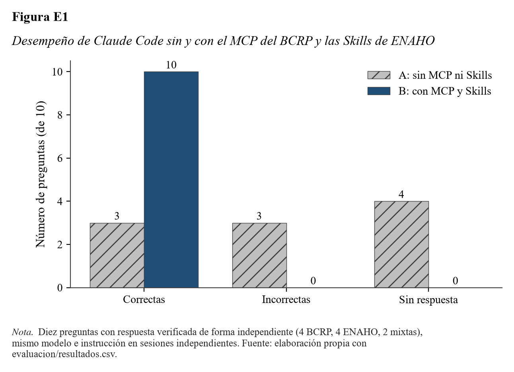

# Comparación de Claude Code sin y con el MCP del BCRP y las Skills de ENAHO

## 1. Diseño del experimento

Se formularon 10 preguntas con respuesta numérica verificable (`evaluacion/preguntas.csv`): 4 sobre series del
BCRP, 4 sobre indicadores de la ENAHO 2024 y 2 que combinan ambas fuentes. Las respuestas esperadas y sus
tolerancias se fijaron con `evaluacion/verdades.py` **antes** de ejecutar a Claude y no se modificaron después:

- **BCRP:** consulta directa a la API pública con `httpx`, sin pasar por el servidor MCP.
- **ENAHO:** cifras oficiales publicadas por el INEI (27.6 %, 39.3 %, 5.5 %) y la referencia departamental de la
  sesión 16 (Cajamarca 45.0 %); como control cruzado se recalcularon desde el `.dta` original con pandas puro,
  sin la skill de limpieza (columna `control_calculado`).
- **Mixtas:** (a) gasto per cápita mensual promedio 2024 (ENAHO) convertido a dólares con el tipo de cambio
  promedio de 2024 (BCRP, PN01206PM); (b) línea de pobreza promedio 2024 (ENAHO) actualizada con la inflación
  de diciembre de 2024 (BCRP, PN01273PM). Para ser correctas deben estar dentro de la tolerancia **y** citar
  ambas fuentes (criterio de coherencia).

| Condición | Modo A: sin MCP ni Skills | Modo B: con MCP y Skills |
|---|---|---|
| Modelo | `sonnet` | `sonnet` |
| Instrucción | Idéntica (valor numérico o `null` si no hay certeza; citar fuente) | Idéntica |
| Sesiones | Una por pregunta, `--no-session-persistence` | Una por pregunta, `--no-session-persistence` |
| Herramientas | Ninguna (`--tools ""`) | `Skill`, `Bash` (solo `uv run`), `Read`, `Glob`, `Grep` |
| MCP | Ninguno (`--strict-mcp-config`) | Solo `bcrp` de `.mcp.json` (`--strict-mcp-config`) |
| Skills | Desactivadas (`--disable-slash-commands`) | Las cuatro del proyecto |
| Directorio | Temporal vacío (sin acceso a `CLAUDE.md`, datos ni resultados) | Raíz del proyecto |
| Salida | JSON validado con esquema (`valor`, `unidad`, `fuente`) | Igual |

Ejecución: `uv run evaluacion/evaluar.py --modos A` y `--modos B` (8 de noviembre de 2026). Cada llamada quedó
registrada completa en `evidencias_ia/evaluacion/<id>_modo<A|B>.jsonl`; los resultados están en
`evaluacion/resultados.csv` y el resumen en `evaluacion/resumen.md` (`uv run evaluacion/resumir.py`).

## 2. Resultados

**Tabla 1**

*Resultados de la evaluación por modo (10 preguntas)*

| Modo | Correctas | Incorrectas | Sin respuesta | Segundos (media) | Turnos (media) |
|:---|---:|---:|---:|---:|---:|
| A: sin MCP ni Skills | 3 | 3 | 4 | 6.6 | 2.0 |
| B: con MCP y Skills | 10 | 0 | 0 | 22.9 | 4.1 |

*Nota.* Correcta = dentro de la tolerancia fijada antes de ejecutar; en preguntas mixtas además debe citar BCRP
e INEI. Fuente: `evaluacion/resultados.csv`.

**Tabla 2**

*Respuestas correctas por tipo de pregunta*

| Tipo de pregunta | Preguntas | Modo A | Modo B |
|:---|---:|---:|---:|
| BCRP | 4 | 2 | 4 |
| ENAHO | 4 | 1 | 4 |
| Mixtas | 2 | 0 | 2 |

*Nota.* Fuente: `evaluacion/resultados.csv`.

**Tabla 3**

*Detalle por pregunta: valor esperado, respuestas y herramientas usadas en el modo B*

| Pregunta | Esperado | Modo A | Modo B | Herramientas del modo B |
|:---|---:|:---|:---|:---|
| Inflación 12 meses, dic. 2022 (%) | 8.459 | 8.46, correcta | 8.46, correcta | `serie` |
| PBI real 2023 (%) | -0.351 | -0.60, incorrecta | -0.35, correcta | `buscar_series`, `serie` |
| Tasa de referencia, dic. 2024 (%) | 5.00 | 5.00, correcta | 5.00, correcta | `buscar_series`, `serie` |
| Tipo de cambio venta, dic. 2024 (S/) | 3.737 | sin respuesta | 3.7366, correcta | `buscar_series`, `serie` |
| Pobreza nacional 2024 (%) | 27.6 | 27.6, correcta | 27.58, correcta | `Grep` sobre `salidas/indicadores.csv` |
| Pobreza rural 2024 (%) | 39.3 | 39.8, incorrecta | 39.30, correcta | `Bash` (`ls salidas`), lectura de indicadores |
| Pobreza en Cajamarca 2024 (%) | 45.0 | sin respuesta | 45.0, correcta | `Grep` sobre `salidas/indicadores.csv` |
| Pobreza extrema 2024 (%) | 5.5 | 5.7, incorrecta | 5.505, correcta | `Grep` sobre `salidas/indicadores.csv` |
| Gasto per cápita en US$ (mixta) | 206.25 | sin respuesta | 206.25, correcta | `serie` + `uv run python` sobre la sumaria |
| Línea de pobreza ajustada (S/, mixta) | 463.32 | sin respuesta | 463.32, correcta | `serie` + `uv run python` sobre `hogares_2024.parquet` |

*Nota.* Valores esperados redondeados; los valores exactos y las tolerancias están en `evaluacion/preguntas.csv`.

## 3. Preguntas que mejoraron o empeoraron

- **Mejoraron (7):** PBI 2023, tipo de cambio de diciembre de 2024, pobreza rural, pobreza en Cajamarca,
  pobreza extrema y las dos preguntas mixtas.
- **Sin cambio (3):** inflación de diciembre de 2022, tasa de referencia de diciembre de 2024 y pobreza nacional;
  las tres son cifras muy difundidas que el modelo recordaba correctamente.
- **Empeoraron:** ninguna.

## 4. Principales errores encontrados

1. **Modo A, cifras recordadas pero desactualizadas o aproximadas.** El PBI 2023 respondido (-0.60 %) se aproxima a
   las estimaciones preliminares difundidas a inicios de 2024, mientras que la serie vigente del BCRP
   (PM04923AA) registra -0.35 %; las cifras de cuentas nacionales se revisan y la memoria del modelo no lo refleja. La pobreza rural (39.8 %) y la extrema (5.7 %)
   están cerca, pero fuera de la tolerancia de 0.1 puntos. Son errores silenciosos: el modelo citó una fuente
   oficial plausible sin poder comprobarla.
2. **Modo A, abstención correcta.** En 4 preguntas (tipo de cambio, Cajamarca y las dos mixtas) el modelo
   devolvió `null` y explicó qué dato hacía falta, en lugar de inventar. Es el comportamiento deseado cuando no
   hay herramientas.
3. **Modo B, uso de la skill a través de sus salidas.** En las preguntas de ENAHO el agente no invocó la
   herramienta `Skill`: leyó `salidas/indicadores.csv`, que la skill `limpiando-enaho` ya había generado y
   validado. La cifra es correcta y rastreable, pero el experimento mide el valor del procesamiento
   reproducible más que la activación de la skill en cada pregunta (la activación se demuestra aparte en
   `evidencias_ia/skills/`).
4. **Modo B, cálculos ad hoc en las mixtas.** Para las preguntas combinadas el agente escribió código pandas con
   `uv run python` sobre las bases procesadas en lugar de usar solo herramientas del proyecto. El resultado es
   exacto, pero esos cálculos no quedan en un script versionado; se registran en los `.jsonl` de evidencia.
5. **Costo en tiempo.** El modo B tardó en promedio 22.9 s frente a 6.6 s del modo A (3.5 veces más), por las
   llamadas a herramientas y la lectura de archivos.

## 5. Conclusión

Con las herramientas especializadas el agente pasó de 3 a 10 respuestas correctas y eliminó las respuestas
incorrectas. La mejora se concentra donde la memoria del modelo es insuficiente: cifras revisadas (PBI 2023),
datos poco difundidos (tipo de cambio mensual, pobreza departamental) y cálculos que exigen microdatos y
ponderadores (preguntas mixtas). El MCP aporta exactitud y trazabilidad (código de serie, periodo y URL); las
Skills aportan un procesamiento validado de la ENAHO que hace que cada cifra sea reproducible. El costo es un
tiempo de respuesta mayor. Como limitación, son 10 preguntas y una sola corrida por modo, por lo que el
resultado describe este conjunto de preguntas y no permite inferencias estadísticas generales.
