# Pobreza monetaria, brechas territoriales y sociales, inflación y actividad económica en el Perú, 2019-2025

## Resumen ejecutivo

- **La pobreza no volvió a su nivel prepandemia.** La pobreza monetaria nacional pasó de 20.19 % en 2019
  (IC 95 %: 19.35-21.04) a 30.13 % en 2020 (29.01-31.25) y fue 25.67 % en 2025 (24.67-26.67): 5.47 puntos
  porcentuales (p.p.) por encima de 2019 (INEI, ENAHO 2019-2025; `factor07 × mieperho`).
- **La macroeconomía sí se normalizó.** La inflación a 12 meses alcanzó un máximo de 8.81 % en junio de 2022 y
  cerró 2025 en 1.51 %, dentro del rango meta (PN01273PM, 2019-01 a 2025-12). El PBI cayó 10.93 % en 2020,
  rebotó 13.42 % en 2021 y creció 3.52 % en 2024 y 3.43 % en 2025 (PM04923AA, 2019-2025).
- **La brecha urbano-rural se cerró por el lado equivocado.** La pobreza urbana subió de 14.58 % a 23.41 % y la
  rural bajó de 40.78 % a 35.46 % entre 2019 y 2025; la diferencia se redujo de 26.20 a 12.04 p.p.
- **El mapa de la pobreza se desplazó hacia la costa.** Siete departamentos cambiaron con IC sin superposición:
  suben Callao (+17.81 p.p.), Tumbes, Lima, Ucayali y Arequipa; bajan Amazonas (−10.10 p.p.) y Junín.
- **Las brechas entre pobres y no pobres en servicios, educación y seguro contributivo se estrecharon** (por
  ejemplo, desagüe por red pública: de 30.68 a 16.56 p.p.), pero se abrió la de ocupación (de 1.35 a 7.06 p.p.).

Todas las asociaciones entre las series del BCRP y la pobreza son descriptivas, no causales. Las 18 cifras
verificadas de forma independiente coinciden con sus fuentes (`informes/verificacion.md`).

## 1. Pregunta

¿Cómo evolucionaron la pobreza monetaria y sus brechas territoriales y sociales en el Perú entre 2019 y 2025, y
cómo se compara esa trayectoria con la inflación y la actividad económica del mismo periodo?

**Objetivo.** Describir la trayectoria anual de la pobreza monetaria y de sus brechas (área, región natural,
departamento, edad, sexo, jefatura del hogar y acceso a servicios, seguro, educación y empleo) y ponerla en
paralelo con la inflación y el crecimiento del PBI.

**Delimitación.** 2019-2025; Perú, área urbana/rural, región natural y 25 departamentos (Lima y Callao por
separado); personas residentes habituales.

## 2. Fuentes y metodología

**BCRP** (Banco Central de Reserva del Perú, 2026), consultado con el servidor MCP del proyecto:
PN01273PM, variación a 12 meses del IPC de Lima Metropolitana (mensual, 2019-01 a 2025-12; herramientas
`graficar_serie`, `resumen_anual` y `resumen`), y PM04923AA, variación porcentual real anual del PBI (2019-2025;
`serie` y `graficar_serie`).

**ENAHO 2019-2025** (Instituto Nacional de Estadística e Informática [INEI], 2020-2026), procesada con la skill
`limpiando-enaho` (`--anios 2019 … 2025`): módulos 34 (sumaria) y 02 (miembros), residentes habituales,
pobreza monetaria (`pobreza ≤ 2`) y extrema (`pobreza = 1`). Estimaciones territoriales y por jefatura con la
sumaria y `factor07 × mieperho`; por sexo y edad con `facpob07`. Error estándar por linealización de Taylor
(UPM `conglome`; estratos departamento × estrato) e IC 95 %. Cada año se validó contra la pobreza oficial
publicada por el INEI (2026) para el total nacional, urbano, rural y extremo: los siete años aprobaron todas
sus verificaciones esenciales (`salidas/validacion_<año>.txt`).

**Brechas entre pobres y no pobres** con la skill `explorando-enaho` (`explorar.py indicador --por pobre`,
2019 y 2025, ponderador `facpob07`): agua (módulo 01, `p110` ∈ {1, 2}), desagüe (`p111a` ∈ {1, 2}), alumbrado
eléctrico (`p1121 = 1`), afiliación a EsSalud (módulo 04, `p4191 = 1`) y al SIS (`p4195 = 1`), secundaria
completa o más en personas de 25 años o más (módulo 03, `p301a ≥ 6`; la codificación es idéntica en los
diccionarios de 2019 y 2025) y ocupación en personas de 14 años o más (módulo 05, `ocu500 = 1`).

**Criterios.** Solo se afirma una diferencia entre años o grupos cuando sus IC 95 % no se superponen; se
advierte cuando el coeficiente de variación (CV) supera 15 %. Ninguna asociación se interpreta como causal.

## 3. Resultados

### Hallazgo 1. La inflación subió con fuerza en 2021-2022 y volvió al rango meta; la actividad se desplomó en 2020 y luego creció de forma moderada

La inflación a 12 meses se mantuvo cerca de 2 % en 2019 y 2020 (1.90 % y 1.97 % en diciembre), subió a 6.43 %
en diciembre de 2021, alcanzó su máximo de 8.81 % en junio de 2022 y cerró ese año en 8.46 % (promedio anual
7.86 %). Desde entonces descendió: 3.24 % en diciembre de 2023, 1.97 % en 2024 y 1.51 % en 2025, con un
promedio de 1.50 % en 2025 y un mínimo del periodo de 1.11 % en agosto de 2025 (PN01273PM; Figura 1, Tabla 1).
El PBI real cayó 10.93 % en 2020, creció 13.42 % en 2021 y 2.82 % en 2022, se contrajo 0.35 % en 2023 y creció
3.52 % en 2024 y 3.43 % en 2025 (PM04923AA; Figura 2).

**Figura 1**

*Inflación a 12 meses de Lima Metropolitana, 2019-2025*

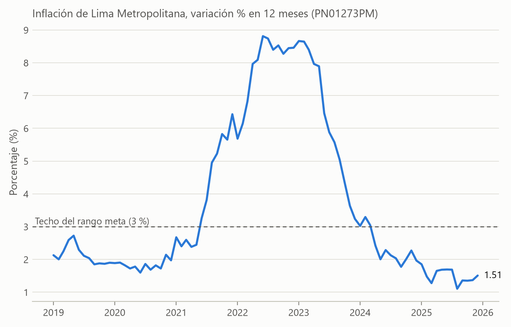

*Nota.* Variación porcentual a 12 meses del IPC de Lima Metropolitana, mensual; línea de referencia: techo del
rango meta del BCRP (3 %). Serie PN01273PM, 2019-01 a 2025-12. Elaborado con la herramienta `graficar_serie`
del servidor MCP. Fuente: Banco Central de Reserva del Perú (2026).

**Figura 2**

*Crecimiento real anual del PBI del Perú, 2019-2025*

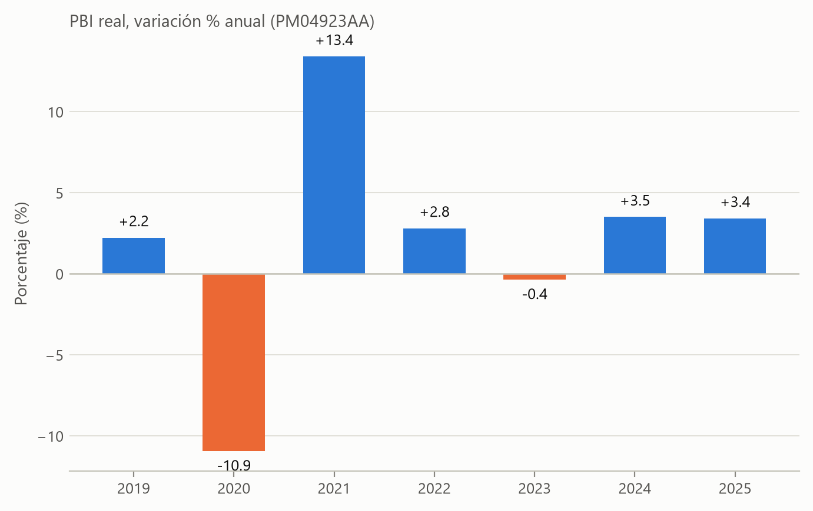

*Nota.* Variación porcentual real anual del producto bruto interno; línea de referencia en 0. Serie PM04923AA,
2019-2025. Elaborado con `graficar_serie`. Fuente: Banco Central de Reserva del Perú (2026).

**Tabla 1**

*Inflación y crecimiento del PBI del Perú, 2019-2025*

| Año | Inflación a diciembre (%) | Inflación promedio anual (%) | Crecimiento real del PBI (%) |
|:---|---:|---:|---:|
| 2019 | 1.90 | 2.14 | 2.24 |
| 2020 | 1.97 | 1.83 | −10.93 |
| 2021 | 6.43 | 3.97 | 13.42 |
| 2022 | 8.46 | 7.86 | 2.82 |
| 2023 | 3.24 | 6.31 | −0.35 |
| 2024 | 1.97 | 2.35 | 3.52 |
| 2025 | 1.51 | 1.50 | 3.43 |

*Nota.* Inflación: variación a 12 meses del IPC de Lima Metropolitana (PN01273PM), valor de diciembre y
promedio de los 12 meses, obtenidos con `resumen_anual`. PBI: variación porcentual real (PM04923AA), obtenida
con `serie`. Fuente: Banco Central de Reserva del Perú (2026).

### Hallazgo 2. La pobreza nacional se disparó en 2020, bajó en 2021 y en 2025 seguía por encima de 2019, aunque la inflación y el PBI ya se habían normalizado

La pobreza monetaria nacional subió 9.94 p.p. entre 2019 (20.19 %) y 2020 (30.13 %) y bajó a 25.87 % en 2021
(IC sin superposición en ambos cambios). Luego aumentó a 27.52 % en 2022 y a 29.05 % en 2023 —años de
inflación alta y de contracción del PBI en 2023—, aunque el cambio 2022-2023 no es estadísticamente
distinguible (IC superpuestos). Entre 2023 y 2025 bajó 3.38 p.p., hasta 25.67 %, con IC sin superposición; el
descenso 2024-2025 (27.58 % a 25.67 %) tiene IC que se tocan (26.59-28.57 y 24.67-26.67), por lo que no se
afirma por sí solo (Figura 3, Tabla 2). La pobreza extrema siguió el mismo patrón: 2.86 % en 2019 (IC 95 %:
2.56-3.15), 5.75 % en 2023 (5.31-6.18) y 4.65 % en 2025 (4.19-5.11). La comparación temporal con las series
del BCRP es descriptiva: en 2025 la inflación estaba en su nivel más bajo del periodo y el PBI llevaba dos años
creciendo, pero la pobreza seguía 5.47 p.p. sobre su nivel de 2019.

**Figura 3**

*Inflación mensual y pobreza monetaria anual en el Perú*

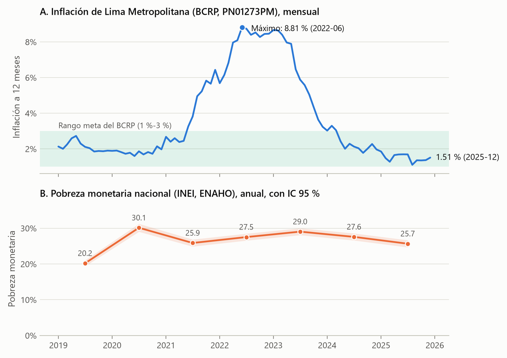

*Nota.* Panel A: variación del IPC de Lima Metropolitana a 12 meses (BCRP, serie PN01273PM). Panel B: pobreza
monetaria nacional con IC 95 %; los puntos se ubican a mitad de año. Paneles separados con escalas propias; la
coincidencia temporal es descriptiva y no implica causalidad. Fuentes: Banco Central de Reserva del Perú
(2026) e INEI, ENAHO 2019-2025 (`factor07 × mieperho`).

**Tabla 2**

*Pobreza monetaria por área de residencia, Perú 2019-2025 (% de personas e IC 95 %)*

| Año | Nacional | IC 95 % | Urbana | IC 95 % | Rural | IC 95 % | Brecha rural-urbana (p.p.) |
|:---|---:|:---:|---:|:---:|---:|:---:|---:|
| 2019 | 20.19 | 19.35-21.04 | 14.58 | 13.57-15.58 | 40.78 | 39.29-42.27 | 26.20 |
| 2020 | 30.13 | 29.01-31.25 | 26.03 | 24.66-27.40 | 45.72 | 44.12-47.33 | 19.70 |
| 2021 | 25.87 | 24.88-26.86 | 22.33 | 21.15-23.52 | 39.71 | 38.13-41.30 | 17.38 |
| 2022 | 27.52 | 26.56-28.49 | 24.14 | 22.97-25.30 | 41.12 | 39.64-42.59 | 16.98 |
| 2023 | 29.05 | 28.08-30.02 | 26.43 | 25.27-27.58 | 39.80 | 38.30-41.29 | 13.37 |
| 2024 | 27.58 | 26.59-28.57 | 24.81 | 23.62-25.99 | 39.30 | 37.80-40.81 | 14.50 |
| 2025 | 25.67 | 24.67-26.67 | 23.41 | 22.22-24.60 | 35.46 | 33.95-36.96 | 12.04 |

*Nota.* Estimaciones ponderadas con `factor07 × mieperho` (método del INEI); IC 95 % por linealización de
Taylor. Todos los CV están entre 1.7 % y 3.6 %. Brecha calculada con los valores sin redondear. Fuente: INEI,
ENAHO 2019-2025 (`salidas/serie_indicadores.csv`, `tablas/evolucion_pobreza_monetaria.csv`).

El deterioro se ve en toda la distribución del gasto, no solo alrededor de la línea: la mediana del cociente
gasto per cápita/línea de pobreza bajó de 1.566 en 2019 a 1.330 en 2020 y en 2025 era 1.451, todavía por debajo
de 2019 (Figura 4). En 2025, 26 de cada 100 peruanos eran pobres y 5 pobres extremos (Figura 5).

**Figura 4**

*Distribución del gasto per cápita respecto de la línea de pobreza, Perú 2019-2025*

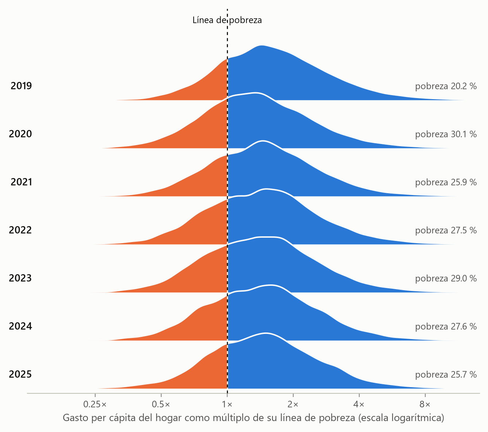

*Nota.* Densidad ponderada por población (`factor07 × mieperho`) del cociente gasto per cápita / línea de
pobreza del hogar (`gashog2d / (12 × mieperho) / linea`). El área a la izquierda de 1× aproxima la población
pobre; la cifra rotulada es la pobreza oficial (variable `pobreza`), que difiere en pocas décimas del cociente
porque el INEI usa su propio agregado de gasto. Fuente: INEI, ENAHO 2019-2025.

**Figura 5**

*De cada 100 peruanos en 2025, 26 eran pobres*

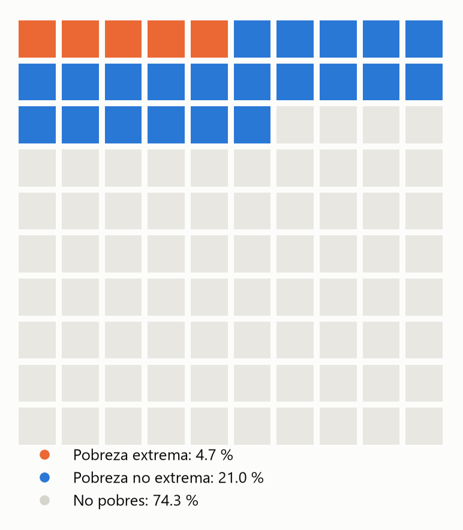

*Nota.* Cada cuadro representa 1 % de la población. Pobreza monetaria 25.67 % y extrema 4.65 % (redondeadas a
cuadros enteros). Fuente: INEI, ENAHO 2025 (`factor07 × mieperho`).

### Hallazgo 3. La brecha urbano-rural se redujo a menos de la mitad porque la pobreza urbana subió y la rural bajó

La pobreza urbana pasó de 14.58 % (IC 95 %: 13.57-15.58) en 2019 a 23.41 % (22.22-24.60) en 2025, y la rural de
40.78 % (39.29-42.27) a 35.46 % (33.95-36.96); ambos cambios tienen IC sin superposición. La brecha
rural-urbana cayó de 26.20 a 12.04 p.p., y la razón rural/urbana, de 2.80 a 1.51 (Figura 6, Tabla 2). La caída
rural se concentró en 2024-2025 (de 39.30 % a 35.46 %, IC sin superposición), mientras que la urbana no cambió
de forma distinguible ese año. Por regiones naturales ocurre lo mismo: la Costa subió de 13.77 % a 23.72 % y la
Sierra quedó estable (29.34 % y 28.61 %, IC superpuestos), de modo que la diferencia Sierra-Costa se redujo de
15.57 a 4.88 p.p. (Tabla 3). La pobreza extrema rural, en cambio, sigue muy por encima de la urbana: 11.41 %
(10.29-12.54) frente a 3.10 % (2.59-3.60) en 2025.

**Figura 6**

*Evolución de la pobreza monetaria por área de residencia, Perú 2019-2025*

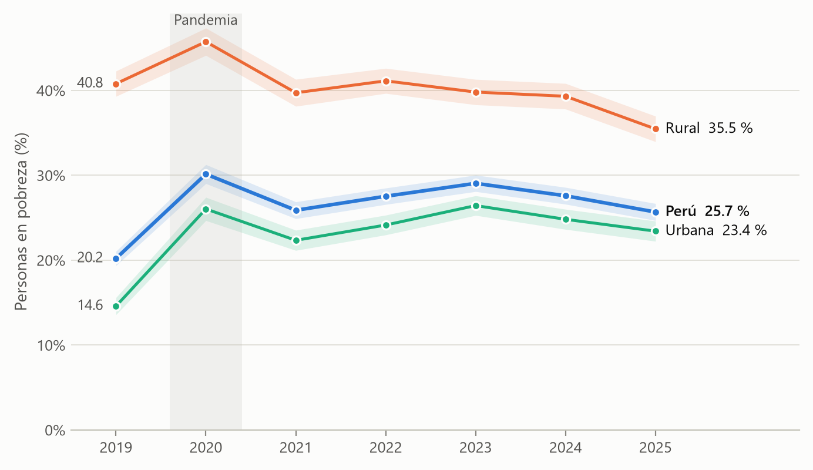

*Nota.* Estimaciones ponderadas (`factor07 × mieperho`, método del INEI); bandas: IC 95 % por linealización de
Taylor. Fuente: INEI, ENAHO 2019-2025.

Entre grupos sociales (Tabla 3), la pobreza aumentó entre 2019 y 2025 en todos los grupos de edad, de sexo y de
jefatura, con IC sin superposición. Los niños de 0 a 13 años siguen siendo el grupo más pobre (35.51 % en 2025;
IC 95 %: 34.10-36.92). No hay diferencia distinguible entre hombres y mujeres en ningún año (2025: 25.38 % y
25.86 %, IC superpuestos). Las personas en hogares con jefe hombre tienen más pobreza que en hogares con jefa
mujer (26.76 % frente a 23.52 % en 2025, IC sin superposición); es una diferencia descriptiva que puede
reflejar la composición de los hogares.

**Tabla 3**

*Pobreza monetaria por región natural y grupo social, Perú 2019 y 2025 (% de personas e IC 95 %)*

| Grupo | 2019 | IC 95 % | 2025 | IC 95 % | Cambio (p.p.) |
|:---|---:|:---:|---:|:---:|---:|
| *Región natural* | | | | | |
| Costa | 13.77 | 12.50-15.04 | 23.72 | 22.21-25.24 | 9.95 |
| Sierra | 29.34 | 28.06-30.63 | 28.61 | 27.16-30.06 | −0.73 |
| Selva | 25.79 | 24.02-27.57 | 27.35 | 25.32-29.38 | 1.56 |
| *Sexo* | | | | | |
| Hombre | 20.18 | 19.30-21.06 | 25.38 | 24.35-26.41 | 5.20 |
| Mujer | 20.16 | 19.29-21.03 | 25.86 | 24.80-26.92 | 5.70 |
| *Grupo de edad* | | | | | |
| 0-13 | 29.24 | 27.99-30.49 | 35.51 | 34.10-36.92 | 6.27 |
| 14-17 | 25.36 | 23.84-26.88 | 32.61 | 30.83-34.40 | 7.25 |
| 18-29 | 16.63 | 15.54-17.73 | 22.77 | 21.43-24.12 | 6.14 |
| 30-44 | 19.95 | 18.88-21.03 | 26.32 | 25.00-27.65 | 6.37 |
| 45-59 | 14.38 | 13.51-15.25 | 19.66 | 18.53-20.80 | 5.28 |
| 60 y más | 14.89 | 14.02-15.76 | 19.68 | 18.56-20.80 | 4.79 |
| *Sexo de la jefatura del hogar* | | | | | |
| Hombre | 21.54 | 20.57-22.51 | 26.76 | 25.60-27.92 | 5.22 |
| Mujer | 16.37 | 14.84-17.90 | 23.52 | 22.01-25.02 | 7.15 |

*Nota.* Región natural y jefatura: sumaria con `factor07 × mieperho`; sexo y edad: personas con `facpob07`. IC
95 % por linealización de Taylor; todos los CV son menores de 5 %. Cambio = 2025 menos 2019, con valores sin
redondear. Fuente: INEI, ENAHO 2019 y 2025 (`salidas/serie_indicadores.csv`).

### Hallazgo 4. El mapa departamental de la pobreza se desplazó hacia la costa y Lima Metropolitana

En 2019 el departamento con la estimación más alta fue Ayacucho (39.35 %) y en 2025 Cajamarca (41.04 %; IC 95 %:
36.63-45.44); en ambos años Ica tuvo la más baja (2.58 % y 4.48 %). El rango entre ambos extremos se mantuvo
cerca de 37 p.p. (36.78 y 36.56). Cajamarca, Loreto (40.11 %), Puno (37.47 %), Pasco (36.40 %) y Huánuco
(35.66 %) forman en 2025 un grupo con IC superpuestos, por lo que no se ordena entre ellos (Figuras 7 y 9).

La pobreza subió en 16 de los 25 departamentos entre 2019 y 2025, pero solo siete cambios tienen IC sin
superposición (Tabla 4, Figuras 8 y 10). Los cinco aumentos están en la costa y la Amazonía urbana: Callao
(+17.81 p.p.), Tumbes (+14.60), Lima (+12.12), Ucayali (+9.44) y Arequipa (+6.81). Las dos disminuciones están
en la sierra y la selva alta: Amazonas (−10.10) y Junín (−7.20). **Advertencia:** en 2025 el CV supera 15 % en
Madre de Dios (29.15 %), Ica (19.29 %) y Moquegua (16.25 %); sus estimaciones son poco precisas.

**Figura 7**

*Pobreza monetaria por departamento y año, Perú 2019-2025*

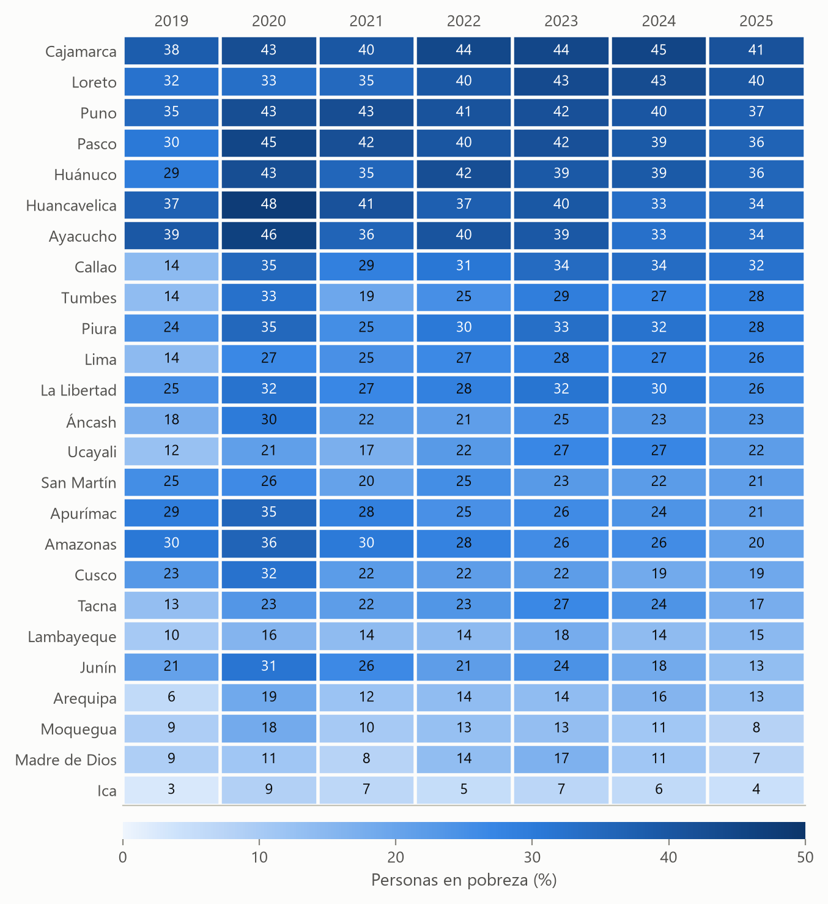

*Nota.* Valores en porcentaje de personas, ordenados de mayor a menor según 2025. Celdas más oscuras indican
mayor pobreza. Estimaciones ponderadas (`factor07 × mieperho`, método del INEI). Fuente: INEI, ENAHO 2019-2025.

**Figura 8**

*Cambio de la pobreza monetaria por departamento entre 2019 y 2025*

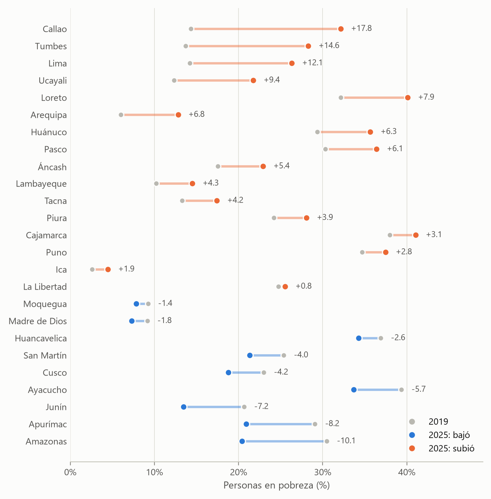

*Nota.* Cada línea une el valor de 2019 (gris) con el de 2025 (color); el número indica el cambio en puntos
porcentuales. Nacional: 20.2 % en 2019 y 25.7 % en 2025. Diferencias pequeñas pueden no ser significativas
(ver Tabla 4). Fuente: INEI, ENAHO 2019 y 2025.

**Figura 9**

*Pobreza monetaria por departamento, Perú 2019-2025*

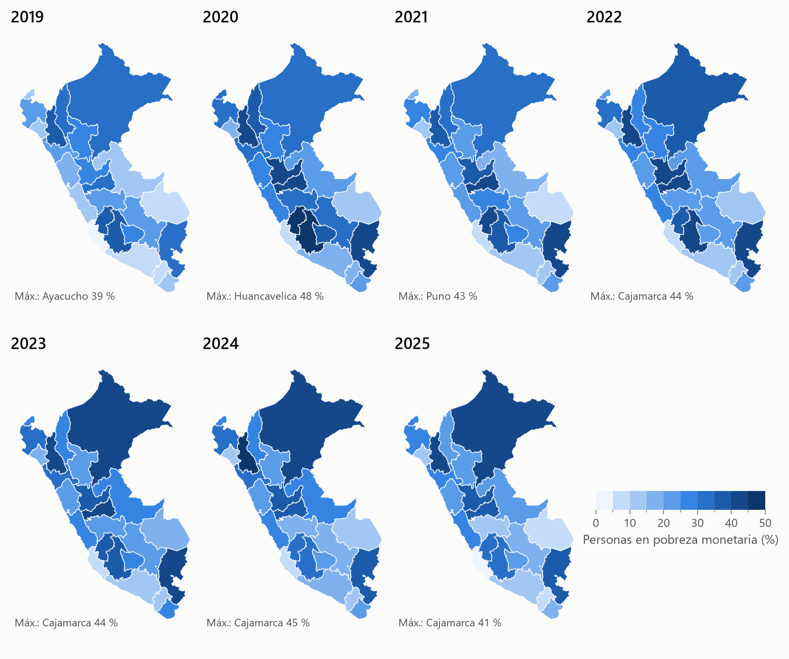

*Nota.* Misma escala de color en todos los años (cortes de 5 puntos). Unión por código `ubigeo[:2]` =
`FIRST_IDDP`; 25 unidades, Lima y Callao separados. Estimaciones ponderadas con `factor07 × mieperho`. Fuente:
INEI, ENAHO 2019-2025; límites departamentales de D2CML (2024).

**Figura 10**

*Cambio de la pobreza monetaria por departamento, 2019-2025*

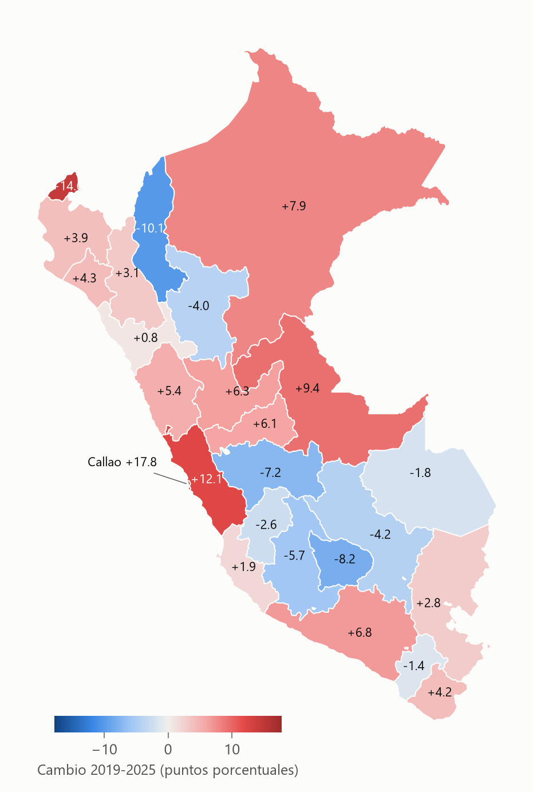

*Nota.* Diferencia en puntos porcentuales (2025 menos 2019); rojo: aumentó (16 departamentos); azul: disminuyó.
Escala divergente centrada en 0. Unión por código `ubigeo[:2]` = `FIRST_IDDP`. Fuente: INEI, ENAHO 2019 y
2025; límites de D2CML (2024).

**Tabla 4**

*Departamentos con cambio de la pobreza monetaria estadísticamente distinguible, 2019-2025*

| Departamento | 2019 (%) | IC 95 % | 2025 (%) | IC 95 % | Cambio (p.p.) |
|:---|---:|:---:|---:|:---:|---:|
| Callao | 14.34 | 10.83-17.86 | 32.15 | 27.77-36.53 | 17.81 |
| Tumbes | 13.69 | 10.20-17.18 | 28.29 | 23.45-33.14 | 14.60 |
| Lima | 14.21 | 12.20-16.23 | 26.33 | 23.94-28.73 | 12.12 |
| Ucayali | 12.32 | 9.37-15.28 | 21.76 | 18.19-25.33 | 9.44 |
| Arequipa | 6.01 | 4.60-7.42 | 12.82 | 9.96-15.68 | 6.81 |
| Junín | 20.66 | 16.89-24.43 | 13.46 | 10.62-16.30 | −7.20 |
| Amazonas | 30.49 | 26.24-34.74 | 20.39 | 16.60-24.18 | −10.10 |

*Nota.* Se listan solo los departamentos cuyos IC 95 % de 2019 y 2025 no se superponen; en los 18 restantes
el cambio no es distinguible con este criterio (por ejemplo, Apurímac −8.19 p.p. y Loreto +7.95 p.p., con IC
que se superponen en menos de 1 p.p.). Estimaciones ponderadas con `factor07 × mieperho`; CV de 2025 entre
4.6 % y 11.4 % para los departamentos listados. Fuente: INEI, ENAHO 2019 y 2025
(`salidas/serie_indicadores.csv`).

### Hallazgo 5. Las brechas de acceso entre pobres y no pobres se estrecharon, salvo la de empleo

Entre 2019 y 2025 la brecha entre no pobres y pobres disminuyó en desagüe por red pública (de 30.68 a 16.56
p.p.), secundaria completa en personas de 25 años o más (de 31.94 a 18.20 p.p.), afiliación a EsSalud (de 24.64
a 17.83 p.p.) y alumbrado eléctrico (de 8.51 a 3.53 p.p.); en agua por red pública pasó de 11.87 a 9.16 p.p.
(Figura 11, Tabla 5). En varios casos la brecha se cerró porque los pobres mejoraron (desagüe 48.89 % → 59.46 %;
secundaria 28.60 % → 44.52 %; EsSalud 7.16 % → 11.55 %) mientras los no pobres quedaron estables o bajaron. Esto
es coherente con un cambio de composición: con la subida de la pobreza urbana, la población pobre de 2025 es
más urbana que la de 2019, y la población urbana tiene más acceso a redes y más años de estudio. No se puede
separar aquí la mejora real de los hogares del cambio en quiénes son pobres.

La única brecha que se amplió es la ocupación: la tasa de ocupación de los pobres de 14 años o más bajó de
67.84 % a 59.93 %, y la brecha pasó de 1.35 a 7.06 p.p. La afiliación al SIS creció en ambos grupos (no pobres
40.79 % → 60.46 %; pobres 75.70 % → 82.44 %) y sigue siendo mayor entre los pobres. Todos los CV son menores
de 7 %.

**Figura 11**

*Brechas de acceso entre población pobre y no pobre, Perú 2019 y 2025*

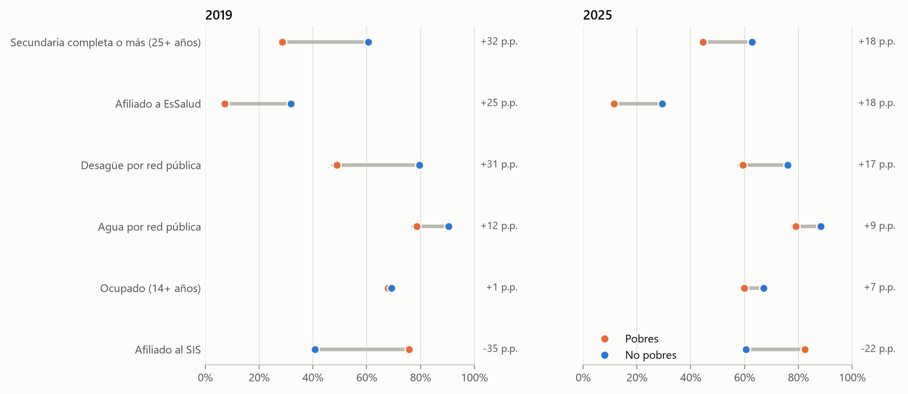

*Nota.* Porcentaje de personas con cada característica; líneas horizontales: IC 95 %. A la derecha, diferencia en
puntos porcentuales (no pobres menos pobres). Variables: módulo 01 (`p110`, `p111a`), 04 (`p4191`, `p4195`), 03
(`p301a`, 25 años o más) y 05 (`ocu500`, 14 años o más); ponderador `facpob07`. El alumbrado eléctrico
(`p1121`) se presenta solo en la Tabla 5. Fuente: INEI, ENAHO 2019 y 2025.

**Tabla 5**

*Acceso a servicios, seguro, educación y empleo según condición de pobreza, Perú 2019 y 2025 (% de personas)*

| Indicador | No pobres 2019 | Pobres 2019 | Brecha 2019 | No pobres 2025 | Pobres 2025 | Brecha 2025 |
|:---|---:|---:|---:|---:|---:|---:|
| Agua por red pública | 90.46 (89.62-91.29) | 78.58 (76.46-80.70) | 11.87 | 88.28 (87.32-89.23) | 79.11 (77.14-81.09) | 9.16 |
| Desagüe por red pública | 79.57 (78.60-80.53) | 48.89 (46.65-51.13) | 30.68 | 76.02 (74.92-77.12) | 59.46 (57.27-61.64) | 16.56 |
| Alumbrado eléctrico | 97.61 (97.39-97.83) | 89.10 (87.95-90.25) | 8.51 | 97.56 (97.30-97.82) | 94.03 (93.28-94.79) | 3.53 |
| Afiliado a EsSalud | 31.79 (31.03-32.56) | 7.16 (6.20-8.11) | 24.64 | 29.38 (28.57-30.20) | 11.55 (10.49-12.62) | 17.83 |
| Afiliado al SIS | 40.79 (39.96-41.62) | 75.70 (74.13-77.27) | −34.91 | 60.46 (59.55-61.38) | 82.44 (81.20-83.69) | −21.98 |
| Secundaria completa o más (25+ años) | 60.53 (59.83-61.24) | 28.60 (27.08-30.11) | 31.94 | 62.73 (61.99-63.47) | 44.52 (43.03-46.02) | 18.20 |
| Ocupado (14+ años) | 69.19 (68.72-69.66) | 67.84 (66.81-68.87) | 1.35 | 66.99 (66.46-67.52) | 59.93 (58.87-60.99) | 7.06 |

*Nota.* Valores con IC 95 % entre paréntesis (linealización de Taylor). Brecha = no pobres menos pobres, en
puntos porcentuales y con valores sin redondear. Condiciones: `p110` y `p111a` ∈ {1, 2}; `p1121`, `p4191`,
`p4195`, `ocu500` = 1; `p301a` ≥ 6. Ponderador `facpob07`; CV máximo 6.8 % (EsSalud, pobres 2019). Calculado
con la skill `explorando-enaho` (`tablas/indicador_*.csv`). Fuente: INEI, ENAHO 2019 y 2025, módulos 01, 03, 04
y 05.

## 4. Interpretación

El periodo 2019-2025 muestra un desacople descriptivo entre los indicadores macroeconómicos y la pobreza. La
actividad se recuperó del choque de 2020 ya en 2021 y la inflación, tras el episodio de 2021-2023, volvió al
rango meta en 2024-2025. La pobreza monetaria, en cambio, quedó en 2025 más de cinco puntos por encima de 2019.
Los años en que la pobreza volvió a subir (2022-2023) coinciden con la inflación más alta del periodo y con la
contracción del PBI de 2023, y su descenso posterior coincide con la desinflación y el crecimiento de 2024-2025;
estas coincidencias son temporales y no permiten atribuir causalidad, entre otras razones porque el IPC mide
precios de Lima y la línea de pobreza del INEI se actualiza con sus propios precios por dominio.

El cambio más marcado es geográfico: la pobreza ya no es un fenómeno predominantemente rural y andino como en
2019. La subida en Lima, Callao, Tumbes, Arequipa y la Costa en general redujo la brecha urbano-rural y la
brecha Sierra-Costa, mientras que la Sierra y algunos departamentos andinos y amazónicos (Amazonas, Junín)
mantuvieron o redujeron su pobreza. Esa convergencia no es una buena noticia en sí misma: se debe sobre todo al
deterioro urbano. Los núcleos de pobreza alta (Cajamarca, Loreto, Puno, Pasco, Huánuco) persisten y la pobreza
extrema sigue concentrada en el área rural.

Las brechas de acceso entre pobres y no pobres se estrecharon en servicios, educación y seguro contributivo, lo
que probablemente refleja en parte la urbanización de la población pobre; la ampliación de la brecha de
ocupación sugiere que, para los pobres de 2025, el problema central es laboral más que de infraestructura.

## 5. Limitaciones

- **Comparabilidad de fuentes.** El IPC (PN01273PM) cubre solo Lima Metropolitana y el PBI (PM04923AA) es
  nacional y anual; la ENAHO mide la pobreza anual por persona. No se estimó ningún modelo: las comparaciones
  son descriptivas y no causales.
- **Error muestral.** Varios cambios departamentales y el descenso nacional 2024-2025 no son distinguibles con
  IC 95 %; en 2025 Madre de Dios, Ica y Moquegua tienen CV > 15 %. El criterio de no superposición de IC es
  conservador (no es una prueba formal de diferencia).
- **Cortes transversales.** Cada año es una muestra distinta (no se siguió a los mismos hogares), por lo que los
  cambios en las brechas entre pobres y no pobres mezclan mejoras reales y cambios de composición.
- **Indicadores de otros módulos.** Se calcularon solo para 2019 y 2025; `p301a ≥ 6` incluye el código 12
  (básica especial), de muy baja frecuencia. La tasa de ocupación no distingue informalidad ni calidad del
  empleo.
- **Figura 11.** No se pudo añadir la etiqueta del alumbrado eléctrico al script de la skill
  `graficando-enaho` (sin permiso de escritura en esta sesión); por eso ese indicador aparece solo en la Tabla 5.
- Las herramientas MCP y las skills no fallaron; la verificación independiente aprobó 18 de 18 cifras.

## 6. Reproducibilidad

```bash
uv sync
# ENAHO: limpieza y validación multianual
uv run .claude/skills/limpiando-enaho/scripts/limpiar.py --anios 2019 2020 2021 2022 2023 2024 2025
# Brechas entre pobres y no pobres (además de las ya calculadas en tablas/indicador_*.csv)
uv run .claude/skills/explorando-enaho/scripts/explorar.py indicador --modulo 01 --variable p1121 \
    --condicion "==1" --nombre alumbrado_electrico --anios 2019 2025 --por pobre
# Figuras ENAHO
uv run .claude/skills/graficando-enaho/scripts/visualizar.py macro --numero 3 --bcrp tablas/bcrp_inflacion.csv
uv run .claude/skills/graficando-enaho/scripts/visualizar.py distribucion --numero 4
uv run .claude/skills/graficando-enaho/scripts/visualizar.py waffle --anio 2025 --numero 5
uv run .claude/skills/graficando-enaho/scripts/visualizar.py evolucion --numero 6
uv run .claude/skills/graficando-enaho/scripts/visualizar.py calor --numero 7
uv run .claude/skills/graficando-enaho/scripts/visualizar.py pendiente --desde 2019 --hasta 2025 --numero 8
uv run .claude/skills/graficando-enaho/scripts/visualizar.py perfil --numero 11
# Mapas
uv run .claude/skills/mapeando-enaho/scripts/mapas_series.py mosaico --numero 9
uv run .claude/skills/mapeando-enaho/scripts/mapas_series.py cambio --desde 2019 --hasta 2025 --numero 10
# Verificación y publicación
uv run .claude/skills/informando-investigacion/scripts/verificar.py informes/afirmaciones.csv
uv run .claude/skills/informando-investigacion/scripts/publicar.py
```

Servidor MCP `bcrp`: `graficar_serie(["PN01273PM"], "2019-01", "2025-12", archivo="bcrp_inflacion.png")`
(Figura 1, `tablas/bcrp_inflacion.csv`); `graficar_serie(["PM04923AA"], "2019", "2025",
archivo="bcrp_pbi_crecimiento.png")` (Figura 2, `tablas/bcrp_pbi_crecimiento.csv`); `resumen_anual("PN01273PM",
2019, 2025)`, `resumen("PN01273PM", "2019-01", "2025-12")` y `serie("PM04923AA", "2019", "2025")` (Tabla 1).
API: https://estadisticas.bcrp.gob.pe/estadisticas/series/api. Cifras ENAHO en `salidas/serie_indicadores.csv`
y `tablas/`; validaciones en `salidas/validacion_<año>.txt`; verificación en `informes/verificacion.md`.

## Referencias

Banco Central de Reserva del Perú. (2026). *BCRPData: Series estadísticas* [Base de datos]. https://estadisticas.bcrp.gob.pe/estadisticas/series/

D2CML. (2024). *Límites departamentales del Perú* [Archivo GeoJSON]. GitHub. https://github.com/d2cml-ai/Data-Science-Python

Instituto Nacional de Estadística e Informática. (2020-2026). *Encuesta Nacional de Hogares sobre Condiciones de Vida y Pobreza, 2019-2025* [Bases de datos]. https://proyectos.inei.gob.pe/microdatos/

Instituto Nacional de Estadística e Informática. (2026). *Perú: Evolución de la pobreza monetaria 2016-2025. Informe técnico*. INEI.
